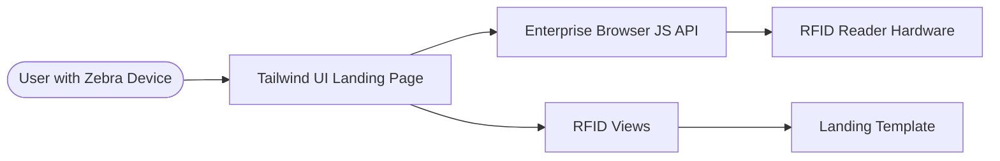

# Requirements

### Overview & Goals
The goal is to provide a clean, high-performance landing page for the RFID scanning application. The interface will be specifically tailored for mobile handheld devices like Zebra scanners, utilizing Tailwind CSS for styling and preparing the ground for Zebra's Enterprise Browser JS API.

### Scope
- **In Scope**:
    - Django URL routing and view for the landing page.
    - Responsive HTML5 template using Tailwind CSS.
    - UI components for RFID status, scan control, and result listing.
    - JavaScript scaffolding for Zebra Enterprise Browser API.
- **Out of Scope**:
    - Backend database persistence for scans (initial phase).
    - Advanced user authentication.
    - Native Android/iOS development.

# Technical Design

### Current Implementation
The project is a standard Django 6.0 structure with an empty `RFID` app. No templates or specific URL routes for the landing page currently exist.

### Key Decisions
- **Styling**: Use **Tailwind CSS** (CDN for initial setup) to ensure a fast, responsive, and customizable UI without heavy CSS files.
- **Integration**: Leverage the **Zebra Enterprise Browser JS API** for hardware interaction, as it allows for deeper control over the RFID reader compared to standard keyboard emulation.
- **UI Pattern**: **Industrial Mobile-First** — focused on high contrast, large touch targets, and clear status feedback to suit warehouse or field environments.

### File Structure
- `RFID/urls.py`: New file for app routing.
- `RFID/views.py`: Updated with the landing page logic.
- `templates/rfid/landing.html`: Main landing page template.
- `scanner_zebra_rfid/urls.py`: Updated to include the `RFID` app.

### Architecture Diagram

# Delivery Steps

### ✓ Step 1: Configure Routing and Initial View
The Django application correctly routes the root URL to the landing page view.

- Create `RFID/urls.py` to handle app-specific routing.
- Update `scanner_zebra_rfid/urls.py` to include `RFID.urls`.
- Implement a `landing_page` view in `RFID/views.py` that renders the template.

### ✓ Step 2: Design Landing Page with Tailwind CSS
The landing page displays a mobile-friendly UI using Tailwind CSS, optimized for handheld scanners.

- Create the `templates/rfid/landing.html` file.
- Integrate Tailwind CSS via CDN for rapid development.
- Implement a high-contrast hero section with a "Start Scan" action and status indicators.
- Design a responsive list component to display scanned RFID tags.

### ✓ Step 3: Implement Zebra Enterprise Browser JS Scaffolding
The application includes the necessary JavaScript to interact with Zebra Enterprise Browser APIs.

- Add a dedicated `<script>` block for Zebra EB API integration.
- Implement logic to detect the `EB` object and initialize the RFID module.
- Add listeners for scan events that update the UI's results list in real-time.