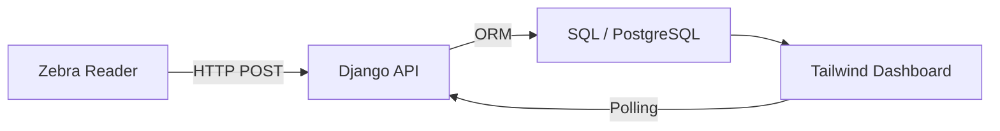

### Zebra RFID Scanner Interface (Django)

A professional, enterprise-focused web interface designed for Zebra FX7500/FX9600 fixed RFID readers. This is a **functional model** with full database persistence, allowing for long-term data storage and integration with external business systems.

#### Use Cases
Designed for inventory tracking, warehouse management, asset monitoring, and ERP systems integration.

#### System Architecture



#### Key Features
- **Real-Time Monitoring**: Live EPC tag list with antenna and RSSI metadata.
- **Hardware Integration**: Optimized for Zebra's HTTP POST push mechanism (IoT Connector).
- **Persistent Storage**: All scans are automatically saved to a database via Django ORM.
- **Mobile-First Design**: Built with Tailwind CSS for warehouse handhelds and Zebra scanners.
- **Diagnostic Tools**: Built-in logging and testing suite for network verification.

---

#### Persistence & Database Configuration

This application is built on the Django framework, meaning it uses a powerful ORM (Object-Relational Mapper) to handle data. It is NOT just a visual sample; every tag read is stored in a structured database.

##### 1. Default Storage (SQLite)
By default, the project uses **SQLite** (`db.sqlite3`), which requires zero configuration and is perfect for small deployments or edge devices.

##### 2. Production Databases (PostgreSQL, MySQL, SQL Server)
Because it uses Django, you can easily switch to a professional database engine. Simply modify the `DATABASES` section in `scanner_zebra_rfid/settings.py`:

```python
# Example for PostgreSQL
DATABASES = {
    'default': {
        'ENGINE': 'django.db.backends.postgresql',
        'NAME': 'your_db_name',
        'USER': 'your_user',
        'PASSWORD': 'your_password',
        'HOST': '127.0.0.1',
        'PORT': '5432',
    }
}
```
*Note: Ensure you install the appropriate driver (e.g., `psycopg2` for Postgres or `mysqlclient` for MySQL).*

---

#### Quick Start

##### 1. Prerequisites
- Python 3.10+
- Access to any Zebra FX series reader (FX7500, FX9600, etc.).
- **Model Compatibility**: This interface is compatible with all Zebra FX-series models (e.g., FX9600-4, FX7500-4, FX9600-8). The specific model suffix does not affect functionality.
- 


##### 2. Installation
```powershell
# Clone the repository
git clone <repository-url>
cd Scanner-Zebra-RFID

# Install dependencies
pip install -r requirements.txt

# Run migrations
python manage.py migrate
```

##### 3. Start the Server
```powershell
python manage.py runserver 0.0.0.0:8000
```
*Note: Binding to `0.0.0.0` is required so the scanner can reach your computer.*

---

#### Hardware Configuration

To connect a Zebra FX reader (Firmware 3.x+):

1. **IoT Connector**:
   - Go to `Communication > IoT Connector > Endpoints`.
   - Add a new **HTTP POST** endpoint pointing to: `http://<YOUR_PC_IP>:8000/api/receive-scan/`.
2. **Interface Mapping**:
   - Map **Tag Data** to your new endpoint.
3. **Primary Mode**:
   - In `Inventory > Settings`, set **Primary Mode** to **IoT Connector**.
4. **Start**:
   - Click **Start** in the `Inventory > Control` menu.

Detailed setup instructions are available in [SCANNER_SETUP.md](./SCANNER_SETUP.md).

- 

Save the changes:


Go to "Connections" and there you go:


---

#### Diagnostics, Testing & Results 

- **Live Logs**: Monitor real scanner traffic in real-time:
  ```powershell
  Get-Content -Path "zebra_traffic.log" -Wait
  ```
- **Simulate Tags**: Test the backend without hardware:
  ```powershell
  curl.exe -X POST http://localhost:8000/api/receive-scan/ -H "Content-Type: application/json" -d '[{"data": "TEST-EPC-12345", "antenna": 1, "peakRssi": -60}]'
  ```

For more diagnostic commands, see [commands.md](./commands.md).

DONE ! 


---

#### Project Structure
- `/RFID`: Django app handling ingestion and storage.
- `/templates`: Responsive Tailwind UI.
- `zebra_traffic.log`: Forensic log for incoming scanner payloads.
- `commands.md`: Advanced PowerShell tools for network debugging.
